  

I'm Kumar Manas, a backend developer from India. I build automation tools, Discord bots, and backend systems that are fast, scalable, and efficient.

Most of my time goes into **[Krypton](https://www.kryptonbot.in/)**, an all-in-one Discord security bot I develop that protects **50K+ servers** and **12M+ users**, and **[Melodius](https://www.melodius.in/)**, a free, ad-free music streaming platform on web, Android, and Windows. *If it's repetitive, it's automated.*

  <a href="https://www.notherhacker.space/"><b>Portfolio</b></a>&nbsp;&nbsp;·&nbsp;&nbsp;
  <a href="https://www.kryptonbot.in/"><b>Krypton</b></a>&nbsp;&nbsp;·&nbsp;&nbsp;
  <a href="https://www.melodius.in/"><b>Melodius</b></a>&nbsp;&nbsp;·&nbsp;&nbsp;
  <a href="#lets-connect"><b>Get in touch</b></a>

## Featured work

  

**Krypton** keeps Discord communities safe with real-time anti-nuke and anti-raid protection, smart moderation and spam detection, tickets, giveaways, logging, and high-quality music playback, all from one bot with **400+ commands across 20 modules**. It runs sharded across multiple clusters, with per-cluster health telemetry and PostgreSQL-backed command analytics powering a public status page.

  <a href="https://discord.com/oauth2/authorize?client_id=906085578909548554&permissions=8&response_type=code&redirect_uri=https%3A%2F%2Fdiscord.gg%2Fkryptonbot&integration_type=0&scope=bot"><b>Add to Discord</b></a>&nbsp;&nbsp;·&nbsp;&nbsp;
  <a href="https://www.kryptonbot.in/">Website</a>&nbsp;&nbsp;·&nbsp;&nbsp;
  <a href="https://dashboard.kryptonbot.in">Dashboard</a>&nbsp;&nbsp;·&nbsp;&nbsp;
  <a href="https://www.kryptonbot.in/status">Live status</a>&nbsp;&nbsp;·&nbsp;&nbsp;
  <a href="https://discord.gg/AruJRBwfAu">Support server</a>

  

**Melodius** is a completely free music streaming platform: no ads and no premium tier holding features back. It pairs full-catalogue search across songs, artists, and albums with **Smart Shuffle**, which keeps re-seeding the queue from whatever is playing. **Live Jams** let friends listen together in real time with a shared queue, skip votes, and playback anchored to server time. **Blends** merge two listeners' tastes into one playlist, and **Music DNA** maps genres, listening heatmaps, top artists, and how your taste evolves. Your library, playlists, and history stay in sync across every device.

  
  
  

### CyborG Solver

High-performance **hCaptcha solving API** built for developers, with fast solves, a **95%+ success rate**, and anti-detection: auto-scaling workers (up to 10 threads), fresh HSW JS with human-like patterns, a RESTful API with key auth, and real-time performance metrics.

**[cybx.space →](https://cybx.space/)**&nbsp;&nbsp;·&nbsp;&nbsp;[API docs](https://cybx.space/documentation)

## Engineering focus

- **Distributed bots at scale:** sharded, multi-cluster Discord infrastructure handling real-time gateway events for 50K+ servers.
- **Production APIs & workers:** REST services with key-based auth, auto-scaling worker pools, and live performance metrics.
- **Real-time & cross-platform:** server-time-synced group listening and a library that stays in sync across web, Android, and Windows.
- **Observability by default:** cluster health, shard latency, uptime, and command analytics surfaced on a public status page.
- **Automation first:** bots, tooling, and integrations that take repetitive work off people's plates.

## Open source

- **[Kryptonv2](https://github.com/ItzYourHacker/Kryptonv2)** Python Open-source Krypton v2: anti-nuke, autoroles, giveaways, welcomer, and VC roles.
- **[CYBORG Music](https://github.com/ItzYourHacker/music)** Python Multi-account Discord music selfbot with Lavalink, 6 streaming sources, 15+ audio filters, Hindi TTS, and an interactive CLI.
- **[Avon](https://github.com/ItzYourHacker/Avon)** JavaScript Discord bot built for seamless music streaming.
- **[Anti-Vanity](https://github.com/ItzYourHacker/Anti-Vanity)** Python Automatically reverts unauthorized vanity URL changes.

## Tech stack

<table>
<tr>
<td><b>Languages</b></td>
<td>

</td>
</tr>
<tr>
<td><b>Backend & data</b></td>
<td>

</td>
</tr>
<tr>
<td><b>Web</b></td>
<td>

</td>
</tr>
<tr>
<td><b>Cloud & DevOps</b></td>
<td>

</td>
</tr>
</table>

## GitHub activity

  

<picture>
  <source media="(prefers-color-scheme: dark)" srcset="https://raw.githubusercontent.com/ItzYourHacker/ItzYourHacker/output/snake-dark.svg" />
  <source media="(prefers-color-scheme: light)" srcset="https://raw.githubusercontent.com/ItzYourHacker/ItzYourHacker/output/snake-light.svg" />
  
</picture>

## Let's connect

Into automation, bots, or backend systems? Feel free to reach out.

  
  
  
  

  

